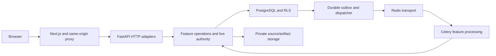

# Project map

10 November 2026. Use this page to explain the project and locate changes.

## The application in a minute

Next.js presents the workspace and proxies typed requests to FastAPI. Identity
establishes the current user/organization and scoped transaction. Thin feature
routes call business operations; PostgreSQL enforces tenant boundaries and stores
committed facts. A durable outbox lets Celery process imports, sources and bounded
analysis. Redis carries dispatch traffic/shared limits; private storage holds bytes.

## Locate a business feature

| Feature | Responsibility |
| --- | --- |
| [agents](../../services/api/ppm_api/modules/agents/README.md) | Read-only specialists, bounded task graphs and independent analysis review |
| [ai](../../services/api/ppm_api/modules/ai/README.md) | Evidence-grounded assistance, budgets and policy-controlled model execution |
| [assessments](../../services/api/ppm_api/modules/assessments/README.md) | Maturity frameworks, assignments, private evidence, independent reviews and scoring |
| [capacity](../../services/api/ppm_api/modules/capacity/README.md) | Workforce records, staffing eligibility, calendars, effort privacy and capacity |
| [command](../../services/api/ppm_api/modules/command/README.md) | Evidence-backed current portfolio metrics and dashboard snapshots |
| [delivery](../../services/api/ppm_api/modules/delivery/README.md) | Portfolio/project records, scoped changes, audit and optimistic concurrency |
| [documents](../../services/api/ppm_api/modules/documents/README.md) | Versioned sources, extraction/OCR, scoped retrieval and controlled retention |
| [identity](../../services/api/ppm_api/modules/identity/README.md) | Accounts, sessions, membership, live authorization and private account mail |
| [integrations](../../services/api/ppm_api/modules/integrations/README.md) | Durable ingestion jobs, bounded adapters, connector authority and source conflicts |
| [ml](../../services/api/ppm_api/modules/ml/README.md) | Versioned history/datasets, reproducible baselines and authorized ML artifacts |
| [selection](../../services/api/ppm_api/modules/selection/README.md) | Explicitly scoped financial-selection fixture research and label review |
| [workspace](../../services/api/ppm_api/modules/workspace/README.md) | Search, personal work, onboarding, cohort comparison and notification receipts |

## The same pattern in each feature

- router.py (and integrations/connector_router.py) contains HTTP signatures,
  validation/response metadata and a direct call to operations. All 129 feature
  handlers follow this rule; routing modules contain no SQL imports.
- service.py owns business operations, authorization/transaction use and feature
  orchestration. Integrations uses the descriptive jobs.py and connectors.py names.
- schemas.py owns typed inputs and response contracts. Command record_schemas.py
  separates writable record types from snapshot DTOs to avoid circular type imports.
- tables.py owns that feature's database declarations. Capacity owns workforce;
  integrations owns connector principals/conflicts; identity owns mail deliveries.
- Larger processing areas already have focused files: assessment access/mutations,
  frameworks/evidence/scoring; document queries/files/lifecycle/worker/parser; agent
  planning/context/validation/runtime; AI model routing/providers/policy; ML pipeline.

Business modules and worker callers use operations directly, without importing
HTTP routers. Function bodies, transaction boundaries, live authority and public
API behavior retain their established rules.

## Shared code and startup

The API root has seven Python files: main (composition/health), config, database,
errors, health schemas, private storage and the package initializer. The
[shared record foundation](../../services/api/ppm_api/shared/README.md) holds common
record fields and table constructors. table_registry explicitly assembles every
feature's metadata for API, scripts, workers and migration checks. The generic
delivery record API composes feature input types and uses this catalogue.

main.py registers the HTTP routers and application resources. The worker task
entrypoint remains services/worker/ppm_worker/app.py, with unchanged task names and
identifier-only envelopes. Applied migration files remain frozen at schema 0020.

## Follow a request or job

Project field: apps/web → typed client/proxy → delivery/router → delivery/service
→ scoped SQL/constraints/audit → response. Document: documents/router → access and
operations → durable job/outbox → integrations/jobs → documents/worker → live
scanner and bounded parser/OCR → authorized publication. Analysis: agents/service
captures scoped facts/evidence, calls bounded task runtime/AI policy and stores
immutable results for an independent review. Python owns authoritative scores and
metrics; model output retains its bounded role.

## Supporting folders

| Folder | Purpose |
| --- | --- |
| apps/web | Next.js pages, UI components and same-origin API proxy |
| services/api | API composition, business features, shared foundation and migrations |
| services/worker | Celery task entrypoints and scheduling |
| packages/contracts | Generated API JSON/types and typed client |
| tests | Backend, browser and tooling regressions |
| infra and config | Pinned container/database setup and public configuration examples |
| scripts | Setup, checks, maintenance and bounded research commands |
| artifacts | Generated evidence and ignored private local runtime output |
| docs | Current maps/contracts/guides and preserved dated evidence |

.venv, node_modules, tool caches, playwright-report and test-results are generated
dependencies/outputs. Original requirements/prompts in docs/source stay preserved.

Read the owning feature guide and contract before a change. See
[current architecture](SYSTEM_ARCHITECTURE.md), [source navigation](../10-reference/CODE-AND-TEST-INDEX.md),
[actual checks](../04-testing/BACKEND_STRUCTURE_STEP_32.md) and
[latest handoff](../handoffs/LATEST.md).
