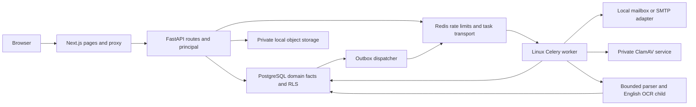

# Current system architecture

Status: **IMPLEMENTED AND VERIFIED** within retained local checks; future design is separately labeled in the preserved proposed architecture. Current source uses a modular monolith, not a separate microservice for each business feature.

| Component / real files | Responsibility / flow |
| --- | --- |
| `apps/web/app` and `components` | Routes/forms/selectors; delivery, resources, assessment, command center, integrations, document library and pilot controls |
| `apps/web/app/api/v1/[...path]/route.ts` | Same-origin proxy forwards to API_ORIGIN and preserves transport/identity behavior |
| `packages/contracts/src/client.ts` | Typed openapi-fetch client; generated schema is derived from actual API |
| `main.py`, `identity.py` | Lifespan/config/health, CSRF/request IDs/errors, sessions and function-scoped principal transaction/tenant context |
| `delivery.py`, `capacity.py`, `assessment.py`, `command.py` | Domain rules with SQLAlchemy statements directly; no universal repository abstraction; deterministic scoring/metrics |
| `jobs.py`, `ingestion.py`, `job_tables.py`, worker | Durable PostgreSQL state/outbox with Redis/Celery transport; CSV/fixture adapters and progress; live connector acceptance open |
| `pilot.py`, `pilot_tables.py`, `account_mail.py` | Scoped search/setup/My work/cohorts/receipts/revision SSE, private account deliveries |
| `database.py`, `*tables.py`, migrations 0001–0012 | Metadata, constraints, tenant/reference keys, app-role RLS, migration-owner/application-role separation |

## Request, authorization and failure flow

Form → typed same-origin request → proxy → CSRF and identity → function-scoped transaction/principal → validation and owning domain rule → transaction-local user/organization/role → RLS/constraints → commit → response → component refetch. Permission is checked at the backend/database, not only by hiding a button. Ownership, role, grants and private effort are distinct.

File bytes and database metadata are not one atomic transaction. Import/outbox authority is PostgreSQL; Redis is transport, not durable business truth. Workspace SSE polls committed authorized revisions and broadcasts opaque change notices; it rechecks sessions and scope, closes on revocation, and clients coalesce refetch. SMTP delivery ambiguity requires honest status; accepted transport is not inbox proof.

Validation returns 422; CSRF/authority denial 403; absent/hidden records and authentication errors follow owning routes; stale revisions conflict; dependency readiness is 503. `main.error_response` provides sanitized errors/request IDs and avoids exposing driver credentials. Debug request ID, route, active organization, revision and source completeness.

## Explicit future boundaries

**IMPLEMENTED, verification in progress:** gateway/budgeted embeddings/protected orchestration (10), Gemini free-tier smoke verified; broader model quality unverified. **PLANNED:** agents/semantic extraction (11), labeled models/forecasting (12–13), copilot (14), later enterprise/release modules (15–23). Existing assessment evidence and fixture ingestion are not a working RAG pipeline. Future vector/graph stores are derived views; no invented endpoint or table appears in current inventories.

See [API details](18-api-contracts.md), [schema](DATABASE-DICTIONARY.md), [authentication walkthrough](../02-learning/05-security/AUTHENTICATION_AND_AUTHORIZATION.md), [formula/data flow](../02-learning/06-ai-and-analytics/SCORING_AND_DASHBOARDS.md), [pilot guarantees](../contracts/pilot.md) and [future design](../09-planning/FUTURE_SPRINT_ROADMAP.md). The established contracts/ADRs retain their canonical locations.

## Sprint 09 source boundary

`documents.py`/`document_tables.py` own immutable versioned private originals, scoped
metadata, derived chunks, assessment references and policy/retention. The existing
PostgreSQL job/outbox and Linux worker now process document-version jobs as well as
integration jobs, with exclusive job-kind references and persisted live actor authority.
ClamAV accepts bytes before bounded parser/OCR execution. Object storage and SQL have
separate commit boundaries; guarded orphan cleanup protects all references/holds,
including hidden archived-project records. Source/version byte identity is SQL protected.

Keyword ranking applies scope before selection; citation and original-ticket reads
revalidate access/latest state/deletion. Candidate/embedding DTOs are interface seams
only. [Practical sequence](../02-learning/06-ai-and-analytics/DOCUMENT_SOURCES.md),
[source contract](../contracts/documents.md), [ADR 015](../architecture/adr/015-document-sources.md)
and [operator guide](../07-setup-and-deployment/DOCUMENT-PROCESSING.md) describe limits,
failure and recovery. Workforce notes and private evidence never become implicit library scope.
## Sprint 10 shared runtime

ai.py extends durable jobs with ai_run_id; AI provider, schemas, retrieval and
evaluation modules own the controlled boundary. Four RLS tables and immutable
snapshots preserve provenance and reservations. Existing source authorization,
identity and metric services remain authority. [Contract](../contracts/ai.md) and
[ADR 016](../architecture/adr/016-budgeted-ai-runtime.md) describe the bounded JSONB
projection deviation, cancellation/replay, redacted diagnostics and blocked provider.
