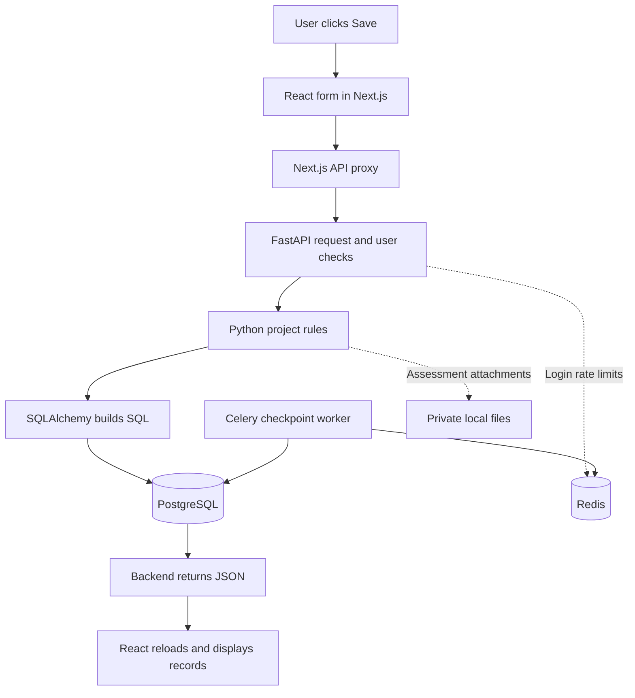

# What AI-PPM does today

[Learning roadmap](../00-getting-started/README.md) · Next: [follow one complete request](../02-backend/REQUEST_LIFECYCLE.md)

## The problem

A project manager may report that a project is Green while a critical milestone is overdue. Another project may need people who are already allocated elsewhere. Without shared records, managers have to compare spreadsheets and ask which numbers are reliable.

AI-PPM stores the facts behind those decisions: projects, dates, budgets, recorded spending, work items, resource calendars and assessment answers. Its command center calculates metrics from the facts the logged-in user may see. Missing information stays visible as missing information.

## Who uses it?

An organization Admin configures the organization and manages access. A Project Manager works on projects covered by their grants, which are stored permissions for a particular project or portfolio. A Viewer reads allowed information. Assessment respondents answer assigned questions; a different assigned reviewer checks those answers. Those assignments add rules beyond the three organization roles.

The source does not prove who personally wrote each feature. For interviews, describe your role as backend engineering and claim only work you can substantiate.

## What can a user do?

| Area | Available in the current implementation | Important boundary |
| --- | --- | --- |
| Account | Sign up/verify, accept invitations, recover passwords, log in, switch eligible organizations and manage sessions | Development Gmail signup, existing-account invitation and recovery are verified; local previews remain an intentional operator-only alternative. |
| Delivery | Manage portfolios, programs, projects, work items, sprints, milestones, blockers and dependencies | Actions need the right role and grants. Lists and selectors are bounded. |
| Money and history | Record approved budgets, spending, reversals, status reports and frozen baselines | A baseline is a saved copy of a plan. Old ledger entries are corrected by adding reversals. |
| Resources | Record calendars, available hours, leave, skills, allocations and effort; inspect capacity | Full workload and private effort require additional access and complete data. |
| Assessments | Build and publish question frameworks, assign people, autosave answers, submit, review and compare results | Published questions are frozen. Evidence files are limited to plain UTF-8 text. |
| Command center | Use Executive, Delivery, Risk and Resource views; inspect metric sources and export JSON | Health is calculated by fixed formulas, and may be Unknown. Export is a fresh authorized read. |
| Background processing | Run durable imports and delivery work alongside a database checkpoint | Durable jobs/imports exist; scheduled business reports remain PLANNED for Sprint 21. |
| AI | Read planned AI requirements | No running LLM, RAG, agent or predictive model workflow was found. |

These are implemented workflows within the stated boundaries, supported by source and recorded acceptance. They are not a claim of production readiness. Chapter [13](../08-deployment-and-operations/OPERATIONS_AND_LIMITS.md) separates complete slices, partial features and plans.

## How the parts connect

1. React runs the interactive form. Next.js provides pages and a server route that forwards API requests.
2. The proxy forwards to the configured backend address. The browser uses `/api/v1/...` on the same website.
3. FastAPI receives HTTP requests. It checks input through Pydantic schemas and resolves the current user through `identity.principal`.
4. Functions such as `delivery.write` check permissions, dates, referenced records and allowed changes.
5. SQLAlchemy sends parameterized SQL through the asyncpg driver. Parameters keep data separate from SQL instructions.
6. PostgreSQL checks row permissions and database rules, then stores changes in a transaction: a group of changes that succeeds or fails together.
7. The backend turns rows into response data. React uses that response to reload the relevant records and update the screen.

The dotted paths are separate supporting uses. Creating a project does not send a Celery task, call Redis for project storage or invoke AI. Assessment file bytes live in private local files; their descriptions and permissions live in PostgreSQL.

## Technologies, in plain words

Python contains backend logic. FastAPI connects URLs to Python functions. Pydantic checks incoming and outgoing data. SQLAlchemy builds database statements, and asyncpg carries them to PostgreSQL. Alembic applies ordered database changes.

React builds interactive screens. Next.js handles routes, builds the web application and provides the API proxy. TypeScript checks frontend types before running. Redis stores shared login attempt counts and worker messages. Celery executes the checkpoint task in another process. Docker Compose runs these services together locally.

Open [`main.py`](../../../services/api/ppm_api/main.py), [`database.py`](../../../services/api/ppm_api/database.py), [`client.ts`](../../../packages/contracts/src/client.ts) and [`compose.yaml`](../../../compose.yaml) to see these connections. The following chapters teach each component with small excerpts from those files.

## Source-reviewed Sprint 8.1 update — 9 October 2026

Signup and setup now let a verified user create their first organization. Workspace search discovers permitted projects, work, risks and assessments; My work provides permitted personal items. The benefits are easier entry and record discovery, not a claim that AI or production release exists.

Status: **IMPLEMENTED AND VERIFIED** within retained local evidence; external gates stay **BLOCKED** or **IMPLEMENTED BUT UNVERIFIED**. See [current status](../../00-overview/CURRENT_STATUS.md), [8.1 evidence](../../03-sprints/completed/sprint-8.1/SPRINT_REPORT.md), [future concept and documentation map](../../09-planning/FEATURE_DOCUMENT_MAPPING.md) and [PLANNED work](../../09-planning/FUTURE_SPRINT_ROADMAP.md).

## Verified Gmail and access update — 10 October 2026

Account email now has real development evidence: personal signup and invitation arrived in Spam, second-Admin signup in Inbox, and recovery receipt/reset/sign-in were confirmed. The same person remained Admin in one organization and became Viewer in another. Learn the boundaries in [account email and role access](../05-security/ACCOUNT_EMAIL_AND_ROLE_ACCESS.md).

## Sprint 09 extension

Versioned source intake, real ClamAV, English OCR, scoped keyword citations, private evidence references and Admin policy/retention now exist locally. [Practical source chapter](../06-ai-and-analytics/DOCUMENT_SOURCES.md) explains their purpose and actual boundaries; embeddings/model intelligence remain later work.
## Sprint 10 evidence runtime

The /ai evidence runtime reuses current sources and jobs; real AI providers are disabled. The existing operational domain remains authoritative.

Read [the practical trace](../06-ai-and-analytics/AI_GATEWAY.md) for actual symbols, flow, failures and debugging. No Sprint 11 semantic agents or automatic changes are implemented.
