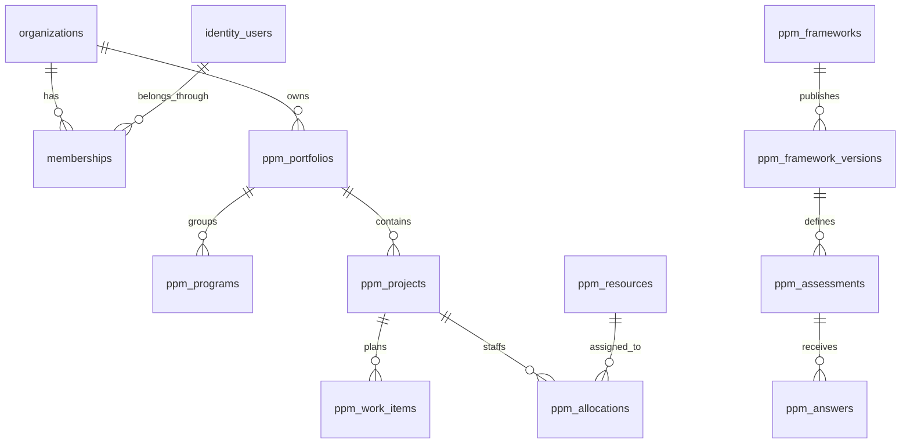

# How the data is stored

[Learning roadmap](../00-getting-started/README.md) · Next: [login and permissions](../05-security/AUTHENTICATION_AND_AUTHORIZATION.md)

## PostgreSQL

**What?** PostgreSQL is the database server. A table stores rows of a particular kind, and a row stores one record.

**Why here?** AI-PPM needs projects and answers to survive page reloads and service restarts. It also needs database rules that stop invalid references or unauthorized rows from being used.

**Where?** `compose.yaml` starts PostgreSQL. `infra/postgres/init.sh` creates local/test/demo databases and separate migration-owner and runtime-app roles. The source table definitions live in `services/api/ppm_api/*tables.py` and `database.py`.

**Real example:** `ppm_projects` stores one project per row. `delivery.get` sends a SELECT with project ID and session organization. `delivery.write` sends INSERT/UPDATE. This data is used by the project screen and command snapshot.

**Internally:** PostgreSQL executes SQL, checks constraints and row policies, then returns rows. Commit makes the transaction's changes permanent. Decimal money uses database numeric columns; project currency is stored explicitly. The app does not combine different currencies through an exchange-rate service.

**If something goes wrong:** a foreign key can reject an invalid relationship; row policies can hide an inaccessible record; a failed transaction is rolled back. A database with the wrong migration revision fails the readiness check.

Remember:

- PostgreSQL stores rows and enforces database rules.
- SQLAlchemy sends statements; Pydantic checks API data.
- A commit makes the grouped database changes permanent.

The [dictionary](../../01-architecture/DATABASE-DICTIONARY.md) is for detailed column lookup after the relationships below make sense.

## Start with these relationships

This diagram shows the main parent/child links. Some child references are optional, such as a project having a program. Exact optionality and composite keys are in the dictionary.

A user is a global login identity. Membership connects a user to an organization and gives them a role there. The same user may have different memberships. A resource is a workforce profile; it need not be a login user and does not gain permission from an allocation.

## The first tables to learn

| Table; what one row means | Important columns and connections | Code and API use |
| --- | --- | --- |
| `organizations`: one organization | `id`, `name`; memberships and business rows refer to it | `identity.account`; GET `/api/v1/auth/me` reports eligible organizations |
| `identity_users`: one login identity | `id`, `email`, `password_hash`, `verified`; connects through memberships | `identity.login`, `principal`; POST `/api/v1/auth/login` |
| `memberships`: one user in one organization | `organization_id`, `user_id`, `role`, `active`, `revision`; organization and user together identify the row | `principal`, `change_member`; GET/PATCH `/api/v1/organization/members...` |
| `identity_sessions`: one login session | User, organization, expiry, revocation and CSRF hash; refers to membership | `principal`, `refresh`; GET `/api/v1/auth/sessions` |
| `ppm_portfolios`: one group of projects | Shared ID/organization/name plus optional owner | Delivery CRUD and `portfolio_summary`; `/api/v1/delivery/portfolios` |
| `ppm_programs`: one optional group inside a portfolio | `portfolio_id`; projects may refer to it | `delivery.refs`; `/api/v1/delivery/programs` |
| `ppm_projects`: one project | Portfolio, optional program/department/team, dates, currency, status, `reported_health`, `ledger_complete`, revision | `write`, `get`, `summary`, `command.snapshot`; project CRUD and `/delivery/project-summary/{id_}` |
| `ppm_grants`: one scoped access grant | User, project or portfolio, `access` read/edit/manage; archived grants stop counting | `grant`, `authorize`; `/api/v1/delivery/grants` |
| `ppm_work_items`: one piece of project work | `project_id`, optional sprint, status, points and dates | `write`, `summary`; `/api/v1/delivery/work_items` |

Delivery endpoints share a prefix `/api/v1/delivery`. Its generic `listing`, `detail`, `create` and `update` select tables through `TABLES[kind]`. The API inventory lists full paths and schema names.

Most delivery rows also have `description`, `archived`, `created_at` and `updated_at`. Archiving marks a row rather than deleting it. `archive_guard` checks active dependents. A revision is the version number checked when editing.

## Then learn the supporting tables

| Table group | Why it exists; main relationships | Producers and readers |
| --- | --- | --- |
| `ppm_sprints`, `ppm_milestones`, `ppm_blockers`, `ppm_dependencies` | Project work periods, gates, impediments and ordering links | Delivery CRUD through each corresponding kind; project board/timeline; `cycle_check`; command snapshot |
| `ppm_budget_lines`, `ppm_expenditures` | Budget plans and recorded spending; both point to a project; expenditures can refer to an original reversal target | Delivery `write`/`summary`; `/delivery/budget_lines`, `/delivery/expenditures`; command snapshot |
| `ppm_baselines`, `ppm_status_updates`, `ppm_audit`, `ppm_requests` | Saved plan, human status report, before/after history and retry receipt | `snapshot`, `audit_change`, `create`; baseline/status CRUD; `/delivery/history/{kind}/{id_}`; receipts have no ordinary UI editor |
| `ppm_resources`, `ppm_calendars`, `ppm_availability`, `ppm_time_off`, `ppm_allocations` | A worker profile, its schedules/leave and project allocations | Delivery CRUD; `capacity.sources_for`/`calculate`; GET `/capacity/resources/{rid}` |
| `ppm_resource_teams`, `ppm_resource_skills`, `ppm_resource_access`, `ppm_effort`, `ppm_effort_coverage`, `ppm_capacity_snapshots` | Team/skill links, separate permissions, recorded hours, completeness statements and saved planning results | Capacity authorization and delivery writes; GET `/capacity/teams/{tid}`, `/capacity/snapshots/{id_}` |
| `ppm_frameworks`, `ppm_framework_versions` | Editable question definition and frozen published copy | `create_framework`, `publish_framework`; `/assessment/frameworks` and publish/versions routes |
| `ppm_assessments`, `ppm_answers` | One assigned assessment and one answer for an assessment/question | `assign`, `save_answers`, `submit`, `review`; `/assessment/assessments...` |
| `ppm_assessment_events`, `ppm_evidence_attachments`, `ppm_assessment_access`, `ppm_assessment_requests` | Action history, file metadata, scoped grants and retry responses | Assessment history/evidence/access routes and mutation wrapper |
| `ppm_risks`, `ppm_benefits`, `ppm_metric_plans`, `ppm_metric_policies`, `ppm_saved_views`, `ppm_sprint_closures` | Risk records, outcomes, calculation inputs/thresholds, personal filters and frozen completed sprint points | Delivery writes; `command.snapshot`; `/delivery/{kind}` for public input kinds and GET `/command/snapshot`; closure is written by sprint lifecycle |

Here `/capacity`, `/assessment` and `/command` also sit under `/api/v1`. Published question IDs are inside framework JSONB, a PostgreSQL type that stores structured JSON. There is no standalone question table. `save_answers` checks question IDs against the frozen version; it cannot rely on a foreign key to a nonexistent question row.

## Keys, indexes and constraints through a project example

A **primary key** identifies a row. `ppm_projects.id` is a UUID primary key. The membership primary key contains both organization and user, because one user's memberships are different rows.

A **foreign key** requires a referenced row to exist. Many project relationships include both `organization_id` and the target ID. A valid program ID from another organization must not become this project's program. The project/program/portfolio relationships also check that the chosen program belongs to the chosen portfolio.

A **unique constraint** stops duplicates. `ppm_requests` makes organization/user/command key unique. `ppm_answers` makes organization/assessment/question unique, so a second save updates the existing answer rather than creating another answer row.

A **check constraint** restricts values. Revisions must be positive; assessment respondent and reviewer must differ; reviewer scores must be between 0 and 100 when present. Constraints protect stored data even outside the normal UI.

An **index** helps locate matching rows and can support uniqueness. Table helpers create organization indexes. An index's presence is not proof of fast queries at production scale; that needs actual measurements.

## Alembic: changing database structure

**What?** Alembic runs database-change scripts called migrations in order. **Why?** Changing a Python table declaration does not change an existing database. **Where?** `services/api/migrations/env.py`, `versions/*.py` and `alembic.ini`.

**Real example:** `0003_delivery.py:upgrade` creates the delivery tables, installs row policies and grants the app role specific operations. `0005_assessment.py` adds assessment storage. The chain currently ends at `0006_command_center`.

**Internally:** the migration owner connects using the migration URL, Alembic reads `alembic_version`, runs missing `upgrade()` functions and records the revision. Compose runs this as a separate migration service before the API becomes ready.

**Failure:** a missing migration leaves the API expecting tables or revision that are absent. Downgrades can remove data. The existing `scripts/test_backend.py` permits its destructive migration lifecycle only on the guarded test database `ppm_test`.

Remember:

- Add a new revision for future schema changes.
- Preserve migrations already applied to existing databases.
- Review row policies, allowed operations and updates to existing rows; generated migrations do not decide these rules for you.

Read [chapter 11](../07-testing-and-debugging/DEVELOPER_GUIDE.md) before adding a table.

To verify these relationships without writes, inspect `ppm_tables.py` and `assessment_tables.py`, then find their `ForeignKeyConstraint` and `UniqueConstraint` declarations in the dictionary. For runtime permission behavior, use the app-role tests; querying as the owner does not exercise the same restrictions.

## Source-reviewed Sprint 8.1 update — 9 October 2026

Migration `0008_pilot_completion` adds nullable delivery metadata and registration/profile support, plus `identity_deliveries`, `personal_notifications` and `notification_preferences`. `pilot_tables.py` defines their columns and membership/token relationships. The notification unique key `(organization_id,user_id,event_key)` prevents duplicate receipts; recipient RLS and live target checks prevent unauthorized names/counts. `account_mail.enqueue` creates private delivery work with the challenge; `deliver_due` processes it. Inspect recorded preservation/restore evidence before proposing any future migration; this audit applies none.

Status: **IMPLEMENTED AND VERIFIED** within retained local evidence; external gates stay **BLOCKED** or **IMPLEMENTED BUT UNVERIFIED**. See [current status](../../00-overview/CURRENT_STATUS.md), [8.1 evidence](../../03-sprints/active/sprint-8.1/SPRINT_REPORT.md), [future concept and documentation map](../../09-planning/FEATURE_DOCUMENT_MAPPING.md) and [PLANNED work](../../09-planning/FUTURE_SPRINT_ROADMAP.md).

## Verified Gmail and access update — 10 October 2026

The email update uses existing `identity_users`, `memberships`, `identity_challenges`, `identity_sessions` and `identity_deliveries`; no new migration was required. Challenges store a digest/purpose/expiry/used state. The private delivery payload must survive transient retry, then is cleared on terminal outcomes. Provider acceptance does not change membership: successful challenge completion does. Recipient-scoped RLS context is needed when reading membership evidence; an unscoped empty result is not proof that no membership exists. See [account email and role access](../05-security/ACCOUNT_EMAIL_AND_ROLE_ACCESS.md).

## Sprint 09 extension

`0011_document_sources` adds `source_documents`, `source_versions`, `source_chunks`, `source_evidence_links` and the exclusive durable-job document/integration reference. Originals have SQL-protected immutable identity; chunks are replaceable derived data. App-role hard deletion is denied; guarded purge preserves tombstones. The narrow Admin retention-reference function includes archived-project holds/references. [Current dictionary](../../01-architecture/DATABASE-DICTIONARY.md) and [source trace](../06-ai-and-analytics/DOCUMENT_SOURCES.md) explain the actual schema; never lifecycle-downgrade normal data.
## Sprint 10 evidence runtime

0012_ai_runtime adds ai_budgets, ai_runs, ai_calls and ai_embeddings. durable_jobs has an exclusive third ai_run_id reference. JSONB vectors are a bounded rebuildable projection; pgvector is not installed.

Read [the practical trace](../06-ai-and-analytics/AI_GATEWAY.md) for actual symbols, flow, failures and debugging. No Sprint 11 semantic agents or automatic changes are implemented.
