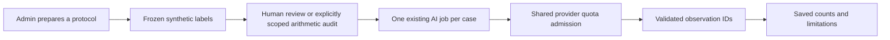

# Sprint 12.1 — Follow the financial selection experiment through the code

## 30 October 2026 — ordinary guided cloud timeout

[Approved timeout follow-up](../../03-sprints/active/sprint-12.1/TIMEOUT_FOLLOWUP.md): new ordinary cloud guided reviews can wait up to **60 seconds**, recorded per run. Normal schema is **0020** after a forward-only migration; all 83 table hashes matched. Existing fixture pilots retain **22 seconds**, the **20-second gate**, and their stopped results. Legacy runs retain their original limit. Shared quotas, $0 policy and access remain unchanged; **AT17 stays BLOCKED**. No new model call, PR, push, deployment or Sprint 13 work.

Validation: 580 full-suite passes plus two corrected test assertions verified in a **28-pass focused rerun** (overlapping); one skip. Migration lifecycle/drift, static/contracts and **two browser journeys** passed. See the linked report for exact evidence and limitations. Earlier dated sections below are historical.

## 28 October 2026 — Sprint 12.1 timing repair

[Current repair report](../../03-sprints/active/sprint-12.1/REPAIR_FOLLOWUP.md) supersedes the operational checkpoint below. Failed calls retain elapsed timing; UI/downloads distinguish unavailable time from accepted-response p95. Separate repair pilot `3f0f3a7f`: **insufficient_data**, 5/12 measured, 5 exact matches, 1 unavailable, 0/6 reserved measured; accepted-case p95 7936 ms. Original ce874a14 history remains unchanged; experiments are not combined. Automated audit records **human_reviewed=false**. Broad **AT17 remains BLOCKED**.

Fresh validation: **566 backend passed, 1 skipped**, one inherited warning; disposable migration lifecycle/drift, two browser journeys, static/contracts and tooling checks passed. Normal schema remains frozen **0019**. Provider configuration, explicit grants, shared limits and $0 policy are preserved. No commit, PR, push, deployment or Sprint 13 work. The single repair experiment is complete under its gate/stop rule; do not start another without authorization.

## Earlier dated checkpoint (historical)

The pilot measures a fixed selection rule with the current Gemini API. It does
not train a model or calculate project finances. The complete
[user walkthrough](../../limitations/FINANCIAL_SELECTION_PILOT.md) and
[review packet](../../09-planning/sprint-12.1/LABEL_REVIEW_PACKET.md) explain the inputs.

[`selection_protocol.protocol`](../../../services/api/ppm_api/selection_protocol.py)
constructs the versioned numeric fixtures and rule-derived expected IDs. These
are synthetic rule-derived labels; review provenance is recorded separately. The six reserved cases
must not be used for prompt tuning or presented as real-world evidence.

[`selection_pilot.create`](../../../services/api/ppm_api/selection_pilot.py) checks
Admin/project/grant authority and stores the protocol binding in
`ai_selection_pilots`. It makes no API call. `approve` checks a different actor,
all twelve cases, current hashes and human attestation; an approval is immutable
through the API. `measure` locks the pilot, enforces order/cooldown and reuses
[`ai.create`](../../../services/api/ppm_api/ai.py) to create a durable job.

For owner-approved pilot ce874a14 only, `automated_review` uses
[`selection_audit.audit`](../../../services/api/ppm_api/selection_audit.py) to check
the pinned original corpus with exact Fraction arithmetic, independently of the
Decimal label generator. The default-empty one-ID local allowlist, current
Admin/grant, unchanged binding and pre-inference checks all apply. This immutable
record says `automated_rule_audit` and `human_reviewed=false`. It never simulates
a personal attestation. Other pilots retain the distinct-person requirement.

[`agent_runtime.complete_task`](../../../services/api/ppm_api/agent_runtime.py)
uses existing SQL provider admission and settlement. Shared account limits and
unknown outcomes cannot be reset by changing a pilot ID. The provider receives
small numeric observations and aliases; source/project IDs remain local.
[`guided_review.validate`](../../../services/api/ppm_api/guided_review.py) accepts
only known IDs and resolves display text/actions from trusted context. Invalid
output leaves a manual checklist, which is never counted as model success.

`selection_pilot.view` reconstructs scores from accepted sections and call records.
It cannot activate a model. Even a twelve-case fixture pass has zero demonstrated
added interpretation and returns AT17 BLOCKED. A plausible ID response or normal
transport smoke is not an accuracy measurement.

To debug missing controls, check current organization, Admin membership, project
selection and explicit guided grant. Four demo Admin roles do not imply that the
extra pilot grant exists. Keep the gate intact and resolve narrow access through
owner authorization. For stale bindings or unavailable cases, inspect the saved
report and existing quota diagnostics; retain history and avoid automatic retry.

[Technical contract](../../contracts/selection-pilot.md) ·
[Sprint report](../../03-sprints/active/sprint-12.1/SPRINT_REPORT.md) ·
[Testing](../../04-testing/sprint-based/sprint-12.1/TESTING_REPORT.md).
