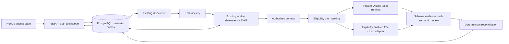
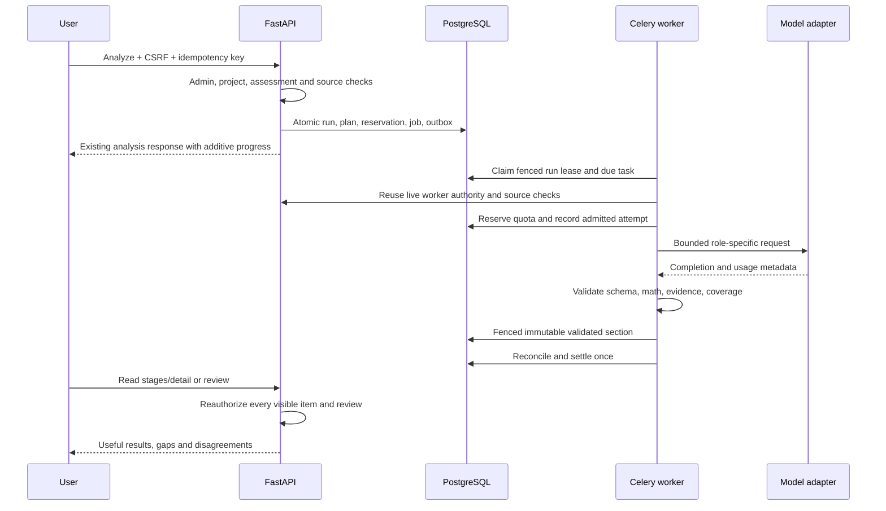
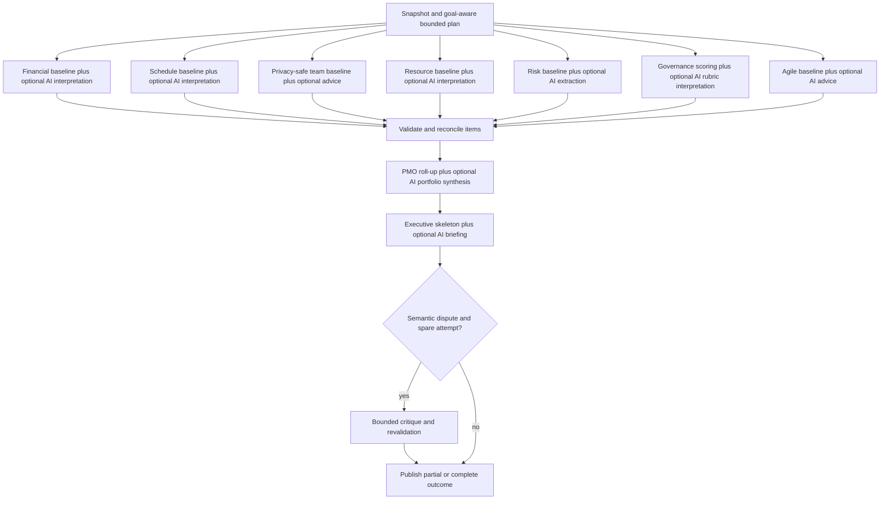

# Target architecture

All new module/type names below are **proposed**. Existing integration symbols are identified in discovery. Select a deterministic, bounded DAG inside the current modular monolith and Celery worker. Do not add another orchestrator service or queue framework.

## Responsibilities and boundaries

| Component / proposed module | Input → output | Responsibility / excluded responsibility | Failure and acceptance |
| --- | --- | --- | --- |
| Capability registry / `agent_registry.py` | versioned definitions → allowed capabilities | Nine stable IDs, inputs, dependency and output schemas; never provider credentials or arbitrary tools | Unknown ID/schema denied; AT01 |
| Planner / `agent_planner.py` | authorized snapshot + request → immutable task plan | Deterministic role selection and section manifest; no LLM planner or recursive delegation | Empty/oversize work explicitly deferred or unavailable; AT02 |
| Orchestrator / `agent_runtime.py` | task plan + live authority → task transitions/final outcome | Dependencies, checkpointing, limits and cancellation via existing Runtime/job lease; no prompt-based control | Restart/cancel fenced; AT06–08 |
| Registry/router / `model_registry.py`, `model_router.py` | task requirements + policy + quota → route or blocked reason | Eligibility first, deterministic ranking second; never financial decisions by model | No eligible provider produces typed block; AT03–05 |
| Execution adapters / `model_adapters.py`, `ollama_provider.py` | ModelRequest → ModelResult/ModelFailure | Fixed destinations, timeout, metadata and bounded transport; no retries within adapters | Finish reasons and unknown outcomes preserved; AT04 |
| Context/evidence / `agent_context.py` | scoped immutable refs → bounded role input + coverage | Reuse capture, retrieval and current authorization; no widened scope or evidence invented by summary | Revoked source blocks dependent item; AT09 |
| Deterministic validation / `agent_validation.py` | section + manifest + evidence → ValidationReport | Schema, source identity, numeric recomputation, coverage, duplication; no semantic certainty from syntax | All hard checks required; AT10–12 |
| Semantic reviewer / `agent_evaluator.py` | disputed claim + authorized excerpt → critique | Optional bounded support/contradiction review; cannot approve, repair missing facts or raise confidence by voting | Unknown stays unresolved; AT13 |
| Recovery policy / `agent_recovery.py` | classified failure + remaining budget → retry/decompose/stop | Deterministic bounded action using same task ledger; no string concatenation of JSON | Global limits survive crash; AT07/11 |
| Reconciler / extend `agent_engine.py` | accepted items and gaps → canonical findings/coverage/synthesis context | Stable IDs, conflict links, numerical roll-up and briefing skeleton; optional PMO/Executive reasoning is separately validated and cannot override these invariants | Material disagreement visible; AT12 |
| Persistence / `agent_task_tables.py` | fenced updates → durable task/attempt/result state | PostgreSQL truth; Celery is delivery only | RLS/composite keys, immutable sections; AT06/09 |
| Diagnostics / existing AI diagnostics and stages | safe events → observable status | Route reason, timings, attempt/coverage/usage counts; no raw prompts, secrets or reasoning | Redaction and tenant isolation; AT14 |

## Deployment and request flow

Windows runs web development/Docker and optionally native Ollama. Existing Linux worker reaches a private explicit Ollama endpoint. A private container-side Ollama service is an alternative if native endpoint isolation cannot be established. No browser-to-model API access. PostgreSQL remains authoritative even if Redis loses all messages; due-job discovery reconstructs dispatch.

## Agent execution graph

In the sequence above, worker reuse of API authority means calling existing Python authorization services inside the worker's transaction, not making a new privileged HTTP request to bypass normal session checks.

Independent tasks are logically parallel; MVP inference dispatch is serial and host-local concurrency is one. Each role has a deterministic baseline and an optional qualified interpretation path. PMO and Executive require terminal selected upstream outcomes, including unavailable/deferred/failed descriptors. Their AI calls require reserved slots when requested; they are not appended after an already exhausted call budget. The diagram shows eligible paths across roles, not nine scheduled calls. Governance alone owns rubric matches, and Python alone owns scoring. The exact goal-aware allocation is in orchestration.

## Key behavior

The nine product roles remain recognizable and all support on-demand AI reasoning. Python owns authoritative calculations, execution and safety checks. Financial, schedule and resource models can interpret selected authorized narrative alongside canonical numbers; PMO can connect validated cross-domain findings; Executive can explain their implications for its audience. Sentiment remains restricted to the existing privacy-safe group contract; a count alone usually needs no model. Risk may propose causal hypotheses but cannot claim causal proof or trained forecasts; later F-076 remains open. Validation is a pipeline, not a tenth infallible agent.

Record base_outcome and semantic_outcome independently. A metric-only request can complete without AI; a requested financial investigation or executive synthesis cannot be declared semantically complete merely because its Python fallback succeeded. Budget/capability/evidence gaps are explicit. Numerical accuracy and semantic usefulness have separate tests, and token pressure cannot justify removing a role's intelligence from its contract.

All candidate suggestions remain reviewable read-only proposals. Cloud fallback cannot widen evidence scope, silently select a paid plan, change a published rubric, hide weaker quality or discard dissent. A complete task may legitimately abstain; required analysis coverage still distinguishes this from fulfilled evidence needs.

Failure scenarios and exact actions live in routing, orchestration and recovery specifications. Defaults intentionally prefer a truthful partial result over exhausting memory, retrying indefinitely or increasing output limits. A 16 GB model benchmark is a qualification gate, not a claim that Qwen3 4B will meet existing 22-second deadlines.
