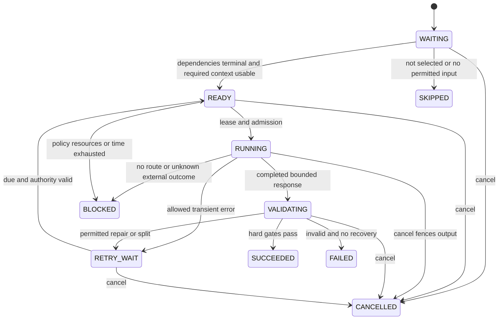

# Orchestration, lifecycle and recovery

Current additive mode: `all_specialists` follows [ADR 17](SPRINT_11_1_DECISION_LOG.md#adr-111-17--four-bounded-batches-and-independent-cloud-acceptance).
Thirteen nodes contain nine baselines and four semantic batches (three/three/two/one
roles). Domain results are validated before PMO; executive prioritizes committed PMO.
Every member must be qualified/assigned, every output is hard-validated, and a batch
shares one logical two-attempt root. Four calls total, including repairs; no evaluator
slot is added. Private assessment answers cannot enter a multi-role batch. Quota
waiting uses the same run/deadline and checks authority. The scheduling algorithm
below remains the automatic/selected-role mode; it does not cap this explicit mode
at three initial sections. Coverage and partial-result rules apply to both.

Proposed runtime-v2 extends existing `ai_worker` and `Runtime`. Database table is **`durable_jobs`** (`job_tables.jobs`); Celery task names are `pipeline.run` and `pipeline.dispatch`. No parallel source of workflow truth is added.

## Plan and bounds

Planner input is authorized `AnalysisInput` plus optional ordered requested agent IDs, selected rubric question IDs and `analysis_mode` (auto, metrics, domain, assessment, portfolio or executive). Missing selection requests all nine role cards; it does not force nine calls. Each role can combine deterministic baseline with qualified interpretation. Plan uses existing IDs and templates only; validate acyclic graph and hard node limit before persistence. Snapshot carries requirements, baseline/interpretation item manifests, prompt/rule/schema/policy versions and evidence. No model can add tasks.

Run hard bounds: four admitted model attempts total; at most two per logical section including repair/decomposition/fallback; 512 output tokens/attempt; 90 s absolute deadline from admission; maximum 24 task nodes including deterministic stages, optional evaluator and one-level repair child. At most three initial semantic sections are scheduled. Optional fourth slot can repair an earlier section or critique a dispute, never manufacture extra budget. The 24-node structural ceiling is separate from four calls.

The three initial sections are a capacity bound, not a fixed set of three specialist names. A section belongs to one role/task class, including synthesis roles. Choose it by the deterministic procedure below. The fourth attempt remains for repair or optional critique, and must still fit the deadline. No nine-call minimum or automatic follow-up runs.

### Interpretation selection and priority

1. Create baseline tasks for requested roles plus read-only dependency baselines. Every role's registry has hybrid_on_demand policy. `analysis_mode=metrics` schedules no model calls, marks interpretations not_requested and completes only the requested baseline scope.
2. For other modes, evaluate each requested role's trigger against the **authorized** manifest. Record interpretation_reason: explicit_request, explanatory_text, conflicting_evidence, cross_domain_synthesis or none. Automatic financial/schedule/resource interpretation needs relevant explanatory text plus adverse/disputed canonical facts; a count/metric alone is not evidence of its cause. Risk/governance/agile need the catalog's text/rubric inputs. Sentiment's current count never triggers automatically; explicit team-support advice may use only its permitted aggregate. PMO/Executive use declared upstream result manifests, not unrestricted retrieval.
3. Explicit `requested_agents` order is the user's priority and is preserved in the v2 fingerprint. `analysis_mode=domain` requires that nonempty list; other modes may omit it. An explicit meaningful interpretation with missing evidence/profile becomes unavailable with a reason. Unrequested dependency roles get baselines only; their presence is not permission for extra inference.
4. Reserve one of the three initial slots for PMO when portfolio mode requests PMO, and one for Executive when executive mode requests Executive. If either is in an explicit requested_agents list, reserve its slot as well. At most one reserved section per synthesis role; requesting both leaves at most one initial upstream model slot. Their dependency baselines cost no model calls. A reserved slot is usable only after dependencies terminalize; no room before deadline means deferred.
5. Fill remaining slots with one first section per eligible requested non-synthesis role. Use explicit list order if supplied. Otherwise mode priority is: assessment = governance,risk,agile_coach,schedule,financial,resource,sentiment; auto/domain/portfolio/executive = risk,governance,schedule,financial,resource,agile_coach,sentiment. Skip roles without a trigger/required input. After first sections, a spare slot may take additional governance question groups (sorted UUIDs), then remaining evidence sections in the same role order and source-ID order. Unreserved PMO/Executive interpretation may use a still-spare initial slot, in that order, after upstream allocation.
6. Freeze the ≤3 initial section identities, dependencies and pending semantic item IDs. Bind the actual terminal upstream outcomes once a downstream task is ready, not before those results exist. Each section covers ≤2 questions, ≤2 findings or ≤2 synthesis items. Requested/needed work with no slot is `deferred`, with exact role/item IDs and BUDGET_OR_DEADLINE_LIMIT. It remains in semantic coverage denominators. A completed numerical baseline cannot satisfy that interpretation. Unneeded interpretation is `not_needed`, not deferred. Do not omit excess scope to report succeeded.

Mode-implied requested synthesis: absent requested_agents means portfolio mode includes PMO and executive mode includes PMO plus Executive; in executive mode reserve both. An explicit list can request Executive alone, using PMO's deterministic dependency baseline without a PMO model call. Model qualification/route eligibility is still checked per selected task; a slot reservation never authorizes a provider.

Input packing budgets include instruction/schema/message overhead, output reserve and 256-token safety margin. Select whole canonical chunks or explicit code-point windows with offset map; never silently discard required rubric/answer pairing. Deterministic preflight can create one-level smaller sections before sending without consuming model attempts, within node/call planning limits. Runtime split after a failed call inherits its logical_section_id and two-attempt cap; only one smaller replacement can be sent. Unprocessed sibling scope remains deferred.

Deterministic baseline stages use the snapshot and owning metric services in all seven domain roles. All nine interpretation paths are available by policy and serial in MVP; no role identity alone requires or forbids a call. Reconciliation is Python-owned and runs before PMO baseline/optional synthesis. PMO waits for selected upstream domain outcomes plus explicit unavailable/deferred descriptors. Executive waits for the PMO outcome (baseline and requested interpretation, if any). Undeclared/unrequested model work cannot appear through a dependency. A terminal unavailable/deferred dependency is not a permanent wait.

The plan contains at most nine baseline role tasks, three initial interpretation tasks, one recovery/evaluator task and deterministic validation/reconciliation/finalization nodes within the 24-node ceiling. Record deferred descriptors in the manifest; they do not require model tasks. A task/section required flag distinguishes requested interpretation from an optional critique. Completing all baselines with required semantic gaps yields partially_succeeded, not succeeded.

Dependency baselines never call back into their downstream role; the graph remains acyclic. PMO baseline waits for selected domain results or terminal gap descriptors, its optional synthesis waits for that baseline, Executive baseline waits for PMO, and its synthesis waits for its own baseline. The final optional critique may invalidate a basis item: deterministically withhold all dependent synthesis items and update coverage before publication, without scheduling another unbudgeted model call.

## Existing run lifecycle retained

Public `durable_jobs.status` values remain `queued`, `running`, `retry_wait`, `succeeded`, `partially_succeeded`, `failed`, `cancelled`. Do not add uppercase states to legacy consumers. Planning/validation/reconciliation are safe stage events; blocked is a structured outcome/diagnostic, not a new legacy job state.

| Transition | Owner / condition |
| --- | --- |
| admission → queued | API transaction: valid authority/idempotency, immutable plan, budget, job/outbox |
| queued/retry_wait → running | worker claim with row lock, new fencing token, due time and live authority |
| running → retry_wait | worker commits waiting next_attempt_at, releases lease; only if waiting fits deadline |
| running → succeeded | all requested scope covered, no unresolved required gap/failed/blocked/deferred task; abstention is explicit but missing required evidence prevents complete analysis |
| running → partially_succeeded | at least one useful validated result/coverage-limited no-findings result and any missing, deferred, failed, blocked or disputed required work |
| running → failed | no useful result; exhausted resources/providers, all unknown, authorization/source failure preventing publish; safe code identifies cause |
| queued/retry_wait/running → cancelled | authorized cancel; pending work stops, in-flight publication fenced; immutable prior sections retained internally, only currently authorized historical display permitted |
| expired unfinished run → terminal | reconciler applies same useful-result rule; DEADLINE_EXCEEDED gaps; no further inference |

All terminal states are immutable; explicit subsequent run gets a new ID/idempotency key and prior_run_id, fresh authorization and budgets. No resume endpoint resets a terminal run or its counters.

## Task lifecycle

Terminal tasks: SUCCEEDED, FAILED, BLOCKED, SKIPPED, CANCELLED. Outcome separate from state: a SUCCEEDED section may report insufficient_evidence, yielding run-level partial coverage. WAITING dependencies missing due corruption become FAILED/PLAN_INVALID; never wait forever. Deadline can terminalize every nonterminal state. Only orchestrator/validator uses compare-and-swap revision plus current run lease. Deterministic crashed tasks can return RUNNING→READY on lease recovery; model tasks with admitted unknown attempt become BLOCKED, never silently replayed. These recovery transitions are explicit exceptions, audited as `task_recovered` or `attempt_unknown`.

## Persistence, transactions and idempotency

API admission remains one transaction: existing actor/session/project/assessment checks, fingerprint, run/analysis, plan/tasks, reservation, durable job/outbox and audit. Old query/index fingerprint rules unchanged. V2 fingerprint includes nondefault selection fields, runtime version, explicit scope, analysis_mode and requested_agents in their supplied priority order. Evidence/question sets are canonicalized separately; do not sort away role priority. Same key/different intent returns 409.

Before provider call: transaction locks run→tenant budget→provider scope→host slot; validates live authority and unchanged policy, checks counters, inserts `ai_calls` with globally monotonic run attempt number and task association, conservatively reserves quota and marks task RUNNING with unique attempt UUID. Commit before external dispatch, no open DB transaction across network.

After call: persist sanitized completion/usage even if payload invalid; valid section result and ValidationReport committed atomically with task SUCCEEDED under matching task revision/run lease. Content hash and unique (task_id,section_id) prevent double publication. Old worker cannot overwrite a newer claim. No result means a persisted unknown attempt, not a free retry.

Final transaction: reauthorize all published evidence and dependencies; assemble immutable analysis output; settle existing USD reservation exactly once using `settled` predicate; update job status/stage. Completion is committed before UI observes terminal status, in one coherent snapshot. Deterministic accepted sections can be reused for finalization after worker loss; validation reports do not substitute for live source checks.

## Lease, cancellation and restart

Keep a run lease, one executing orchestrator/run; no independently scheduled child workers in MVP. Extend lease every 10 s to min(now+30 s, run deadline) under fencing token, including during HTTP wait. Initial claim uses same 30 s extension for v2, while legacy retains 75 s. Worker poll/dispatcher cadence remains 10 s. A heartbeat failure stops new dispatch and fences publication. Provider request timeout cannot exceed remaining run time minus 5 s publication reserve.

Model timeouts: existing general cloud 12 s, Gemini completion 22 s; proposed Ollama completion 22 s, local embed 12 s. At least full configured attempt timeout plus 5 s must remain before dispatch. Four 22 s attempts will not always fit 90 s; admission may block the last attempt. Never shorten response into apparent success or extend deadline silently.

Cancellation transaction sets cancel_requested and terminal cancellation using existing endpoint authority. Abort cooperative HTTP; retain quota for possibly sent attempt; fence all late results. Do not release local host slot solely because coroutine timed out: disconnect transport and quarantine an occupied/unknown endpoint. Release only after a transport/runtime completion or cancellation acknowledgement known to stop that request, or an operator-confirmed idle/restarted runtime. Generic health and `/api/ps` residency checks do not prove the old generation stopped; do not send a canary generation into an unknown occupied slot. Quarantine survives lease expiry/restart. A deliberate idle/reset operation is operator-owned, never a model tool. An old request may still compute; exactly-once upstream inference is not promised.

On restart, existing `ppm_due_jobs()` must include unfinished expired-lease v2 jobs and retry_wait jobs. Claim with new token; reauthorize session, project, assessment and source dependencies. Preserve SUCCEEDED immutable sections. READY/WAITING untouched; crashed deterministic computation requeues safely; VALIDATING with fully persisted response can revalidate without a call; admitted model attempt lacking a recorded response becomes BLOCKED/OUTCOME_UNKNOWN and consumes original attempt/quota. Continue unrelated pending sections only if original deadline remains and safety/limits permit. Do not launch replacement for an ambiguous external attempt automatically after restart; an explicit new user run may retry narrowed scope.

Authorization expiry fails closed; no immortal background service identity is introduced. Changed evidence invalidates dependent sections; unrelated currently authorized sections can survive. Changed assessment revision invalidates all assessment-derived sections, not financial/schedule metric-only sections. Changed model/policy snapshot blocks old tasks instead of mutating them to new defaults.

## Partial success and synthesis

Seven capabilities succeed and two fail: keep the seven validated results; PMO/Executive consume terminal outcome descriptors and include failed IDs/reasons/coverage, with run partially_succeeded. If PMO/Executive interpretations fail, preserve the upstream sections and useful deterministic roll-up/briefing, while marking their semantic outcomes failed. If no useful result remains, failed. Numeric aggregate cannot use an unknown as zero. Requested but omitted role interpretations, assessment questions or selected sources remain explicit deferred IDs. Each role card shows baseline and semantic coverage separately; method is deterministic, semantic or hybrid according to actual executed stages, never a hardcoded role split.

Worked allocation: explicit executive-only request reserves one Executive call, runs needed dependency baselines and may finish with one model call; it does not spend three calls on risk/governance/agile first. Explicit financial/schedule/resource investigation can assign all three initial calls to those roles. An explicit nine-role interpretation request can fit at most three initial semantic sections and must report the other requested sections deferred; their baseline checks do not conceal the gap.

No finding gains credibility because several roles share a model or source. Use normalized claim identity for duplicates, preserve semantic conflict groups and evidence. Final human acceptance follows existing independent review rules; it neither resumes failed tasks nor applies business edits.
