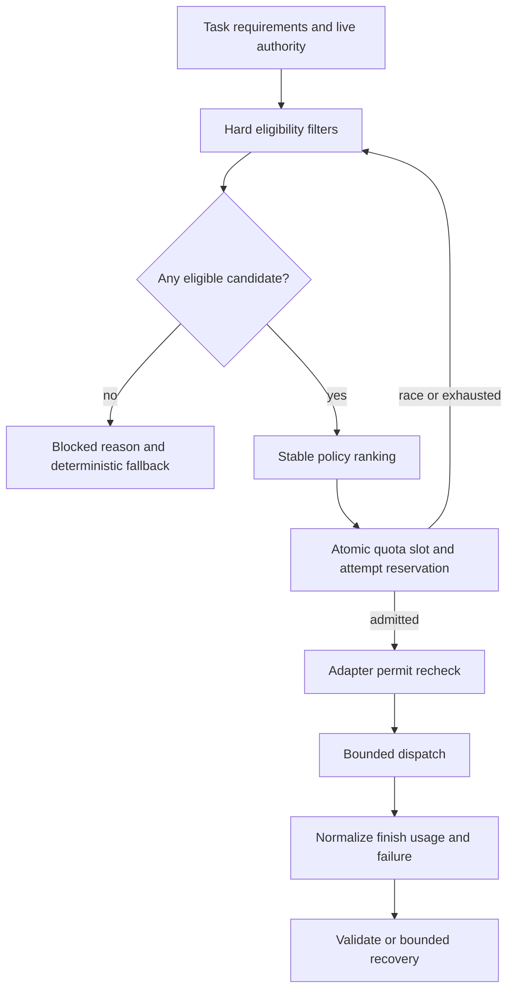

# Provider-independent execution and routing

Proposed runtime-v2 specification; existing `ai_provider.Provider` remains a compatibility facade until T09. No cloud provider is activated by this document.

## Execution interface

```python
class ModelAdapter(Protocol):
    async def capabilities(self, model_id: str) -> ModelCapabilities: ...
    async def health(self, model_id: str) -> ModelHealth: ...
    async def execute(self, request: ModelRequest) -> ModelResult: ...
```

`ModelRequest` contains provider_id/model_id, task_id/attempt_id, operation (`completion`/`embedding`), system instruction, data messages, schema name/hash/schema, input estimate and estimator version, num_ctx, max_output_tokens, absolute deadline, connect/read timeout and cancellation event. It also contains a non-serializable policy permit minted after atomic admission; secrets are resolved server-side. Model messages contain no authorization token or database identity. Adapter must reject absent/expired/mismatched permit, unexpected origin/model/operation and changed credentials/policy. No automatic retries in SDK/transport.

`ModelCapabilities`: text, structured mode (`json_schema`, `json_object`, `none`), supported JSON-schema subset/version, streaming, cancellation (`disconnect_only`, `acknowledged`, `none`), thinking-disable support, embedding dimension set, provider max context/output, configured operational limits, qualified task classes, tokenizer/estimator version, residency and retention policy IDs. A syntactically capable but unqualified model may run only labeled synthetic benchmark tasks; it is not a qualified user fallback.

`ModelResult`: attempt_id, provider/model and resolved revision/digest if known, text or vectors, completion (`complete`, `incomplete`, `refused`, `unknown`), native_finish_reason (bounded allowlisted text), input/output/reasoning token counts nullable, usage_source (`reported`, `estimated`, `unknown`), latency/load time, sanitized request ID, output bytes and policy/config hash. Missing token data is null, not zero. Preserve unknown usage on parse errors/timeouts separately from valid payload. Never expose thought text/signatures. Actual invoice is not inferred from conservative reservations.

Streaming is false in MVP; UI streams/polls persisted stages only. A later stream must buffer bounded output privately and cannot publish model tokens before validation. Unsupported requested streaming yields UNSUPPORTED_CAPABILITY. Cancellation disconnects transport where possible and fences publication; disconnect is not proof of zero upstream compute or quota consumption.

## Registry and eligibility

Registry is operator-owned, versioned JSON configuration loaded by Pydantic (`model_registry.py` proposed), not model output. Each entry has exact provider/model IDs, role/task-class eligibility, enablement, secret reference, fixed endpoint, credential binding, billing classification (`local`, `verified_free`, `paid`, `unknown`), provider account/project quota_scope, explicit operation allowlist, capability/quality record, priority, quotas, concurrency and egress policy. Mutable tags are resolved to installed digest before admitting local work. No `latest` or automatic model upgrade for cloud entries.

All nine role definitions have hybrid_on_demand execution policy. Route requirements come from the selected task class: financial_interpretation, schedule_interpretation, team_support_advice, risk_extraction, resource_interpretation, governance_interpretation, agile_advice, portfolio_synthesis or executive_synthesis. A model can be qualified for a subset; do not infer portfolio/executive competence from extraction success. No hardcoded exclusion of financial/schedule/resource/sentiment/PMO/Executive from inference. Planner trigger/goal rules decide whether interpretation is useful and selected; provider eligibility is a separate gate. Metrics-only work never invokes the router.

Portfolio/executive calls receive only role-permitted derived context with accepted item aliases and original supporting evidence; they cannot obtain broader project/private-assessment access by requesting a different model. Synthesis support is an explicitly qualified task capability, not permission to change canonical numbers. The planner reserves requested synthesis slots within the same four-attempt ceiling, rather than appending extra calls after domain work.

Eligibility is a conjunction, evaluated before ranking and again immediately before network dispatch:

1. Current principal/session/membership/project/assessment/source authority valid; no cancellation and time remains.
2. Deployment and tenant enable this provider/model/operation; local_only excludes all cloud endpoints including Ollama cloud models.
3. Real-cloud authorization and credential-bound account/project confirmation exist; key presence alone is insufficient. Project egress policy allows each data category and provider retention/training terms. Sensitive workforce input is never exported.
4. Spending mode defaults zero. Only `local` or `verified_free` allowed. Missing budget/classification fails closed. Paid API capability can remain in legacy code, but never enters a zero-mode route.
5. Required text/schema/embedding features and task quality qualification are satisfied. Unsupported schema keywords reject profile before request, not silently drop constraints.
6. Full serialized input including schema/messages fits operational context and provider input-byte bound; output reservation fits max output. Unknown token estimate uses conservative UTF-8 byte bound plus 256 token reserve. If it cannot fit, pack/decompose or block; never silently truncate.
7. Provider not disabled by auth error, quota cooldown, open circuit, uninstalled local model, unreachable host or memory gate.
8. Both tenant and provider-scope quotas, rate tokens and concurrency have capacity; global run attempt cap and deadline allow admission.

Ranking among eligible candidates uses a stable tuple: configured task-class priority (lowest first), configured quality tier (highest first), observed latency bucket (fast/normal/unknown), provider_id, model_id. These are deterministic configuration/telemetry inputs, never an LLM judgment. Default local_only has local model first; hybrid default also local first. Operator may rank qualified Gemini first for rubric work without changing governance business code. No random routing, price-zero assumption or key rotation to evade limits.

Atomic admission can lose a race after ranking. Re-read eligibility and try the next eligible candidate once per candidate within deadline; no network attempt is recorded when capacity was never granted. Quota waits use persisted next_attempt_at, not a busy worker sleep.



## Error taxonomy and actions

Every failure has code, category, outcome_certainty (`not_sent`, `completed`, `unknown`), retryable_hint, http_status nullable, retry_after_seconds nullable, sanitized diagnostic and route ID. Policy, not adapter hint alone, decides retries. At most two attempts/logical section and four/run, including repair, evaluation, embedding and fallback.

| Internal category | Detection/example | Required action |
| --- | --- | --- |
| SUCCESS | terminal complete and valid envelope | Pass to validation, not automatic semantic acceptance |
| TRUNCATED | length/MAX_TOKENS/done_reason length | No partial JSON acceptance; smaller one-item section replacement if remaining slot/time; retain originals privately only under retention policy |
| INVALID_OUTPUT | complete but invalid JSON/schema | One repair using error codes and same evidence; no relaxed schema |
| CONTEXT_LIMIT | context overflow or explicit input-too-large | Deterministic repack/decompose; no same-payload retry |
| TIMEOUT | response deadline/disconnect | Mark outcome unknown if possibly sent; consume reservation; avoid repeated same provider in this run; compatible independent fallback only if slot/time exists |
| UNAVAILABLE | network refused/5xx | Not-sent transient may retry once after 1 s; 5xx may have unknown outcome and consumes slot; circuit after three consecutive provider failures for 30 s |
| RATE_LIMIT | 429 with known short reset | Persist cooldown for quota scope; honor retry-after (minimum 1 s, bounded by deadline); only independent authorized provider fallback |
| QUOTA_EXHAUSTED | daily/project exhausted or ambiguous 429 | No same-scope key/model switching to bypass cap; scope blocked until known reset; unknown reset requires operator refresh or local route |
| AUTHENTICATION | 401/403 credential rejection | Disable credential binding until changed/revalidated; no retry; other independently authorized route allowed |
| UNSUPPORTED_CAPABILITY | schema/model feature mismatch | Exclude profile; select eligible route, never silently loosen requirements |
| MODEL_NOT_INSTALLED | Ollama tags/show lacks configured digest | No automatic download; local route ineligible and clear operator reason |
| LOCAL_RESOURCE | OOM or host memory gate | Quarantine host/model until health recovery, unload only after no active inference; no immediate reload loop; qualified smaller model or cloud if authorized |
| CONFIGURATION | malformed registry/model changed/endpoint mismatch | Block affected run; record config mismatch, no silent migration |
| SPENDING_NOT_AUTHORIZED | paid/unknown billing, missing cap | Fail before network; no retry or paid fallback |
| REFUSED | safety stop/no response candidate | Explicit unavailable; no provider switching to evade refusal |
| CANCELLED / AUTHORITY_REVOKED | live run/principal invalid | Fence all publication, cancel pending work, release only unused reservations |
| UNKNOWN | unclassified response/exception | Sanitize; default non-retryable and unknown outcome if sent; preserve partial results |

Cloud quota failure can fall back to local without repeating the exhausted project request. Lower-quality fallback must meet the task's minimum qualification; if it does, show `degraded_route` with its model identity and same validation. Otherwise abstain. All providers unavailable produces capability blocked; run status mapping is defined in orchestration.

## Provider translation

Ollama: private allowlisted base URL, `/api/tags` and `/api/show` read-only health/model checks; `/api/chat` with format JSON schema, stream=false, think=false when supported, options.num_ctx=4096, options.num_predict≤512, temperature=0, bounded keep_alive. Require `done=true`; map `done_reason`, prompt_eval_count/eval_count and timings; unknown finish is incomplete until adapter contract establishes completion semantics. No tools, model pull/create/delete or cloud routes through the app. `/api/embed` uses truncate=false and dimensions=256 only for a qualified model supporting that dimension. Validate actual vector length/finite/nonzero values; do not trim arbitrary embeddings to fit.

Gemini: preserve exact existing allowed IDs and zero-billing binding, fixed Google origin, minimal thinking/no thoughts, responseJsonSchema and STOP requirement. Normalize MAX_TOKENS to TRUNCATED, auth/quota separately, null usage honestly. New policy wrappers preserve existing non-expiring confirmation behavior. Exact model IDs verified in public pricing on 17 October 2026; account eligibility remains separate.

OpenAI: legacy paid transport remains disabled in zero mode. Map finish_reason including length/refusal/tool requests before parsing. A future paid profile needs explicit provider/model/currency/budget authorization and conservative per-attempt reservation, not merely positive config prices. No live paid smoke test belongs to this implementation package.

Groq: future optional adapter uses explicit fixed origin and reviewed model ID; structured output support is model-specific. Keep empty model allowlist and enabled=false until T12 verifies account Free tier, operation/capability, quotas and egress authorization. Organization-scoped limits apply across keys. Do not use paid tier with a guessed “free quota”.

## Quota, cost and admission correctness

Retain tenant budgets for compatibility; add provider-scope request/token accounting shared across all tenants using the same external project/organization and all aliases/keys. Key hash is not quota identity. Record call time (not run creation time), operation and estimated reservation. Admission is transactionally serialized in fixed order: run row → tenant budget → provider-scope row → local-host slot. Enforce request/minute, requests/window, tokens/minute, concurrency and remaining run attempts. Unknown provider limits disable cloud profile until configured; defaults must never imply unlimited.

Provider-scope counters are not directly selectable by tenant app users. Use a narrow owner-defined SQL admission/settlement function with fixed search_path, no dynamic SQL, live tenant binding, internal permit and audited IDs. It returns admitted/denied plus safe cooldown, not other-tenant usage. Provider quota updates and `ai_calls` insertion commit together. This avoids distributing secrets or disabling RLS globally.

Reserve input estimate + maximum output tokens before sending; refund unused token reservation only with trustworthy reported usage. Unknown attempts retain conservative reservation until window expiry; they are not zero usage. Free/local USD cost is exactly zero but request/compute quotas remain enforced. Any future paid reservation must include reasoning tokens and known maximum pricing; missing pricing blocks the route. Rate-limit response may tighten, never expand, configured caps.

Client-side policy cannot prevent a provider billing change made outside the app. Zero-spend cloud mode requires an externally verified non-billable project/account boundary; if that cannot be established, use local-only. Non-expiring confirmation is retained, with event-driven invalidation on binding/model/tier change and operator-visible review dates, not automatic daily expiry.

## Proposed configuration example

```json
{
  "schema_version": "model-policy-v1",
  "mode": "local_only",
  "spend_limit_usd": "0",
  "max_attempts_per_run": 4,
  "max_output_tokens": 512,
  "profiles": [{
    "id": "local-qwen4",
    "provider": "ollama",
    "model": "qwen3:4b",
    "enabled": false,
    "installed_digest": null,
    "billing_class": "local",
    "context_tokens": 4096,
    "concurrency": 1,
    "priority": 10,
    "qualified_task_classes": [],
    "benchmark_only": true
  }]
}
```

This deliberately non-enabled sample cannot make a request. Complete endpoint, digest, memory reservation and qualification data during setup. Cloud credential material belongs only in existing ignored operator secret storage; config contains secret references, never keys.
