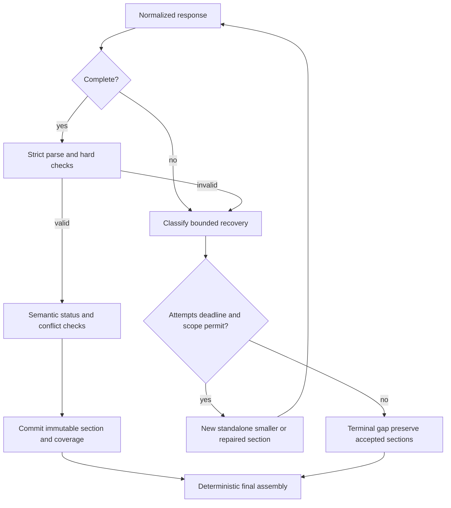

# Validation, quantification and bounded recovery

The quantifier is a layered service, not a truth-producing LLM. Acceptance distinguishes identity/shape checks, deterministic numerical correctness, semantic interpretation and independent human review.

## Pipeline and report

1. Confirm transport terminal completion, expected model/task/schema and bounded bytes. A valid-looking JSON object with MAX_TOKENS is still incomplete.
2. Parse strict JSON once. Reject unknown keys, booleans as numbers, NaN/Infinity, wrong enums and oversized lists/strings.
3. Check manifest identity and coverage: section ID, requested question/source aliases, mandatory fields and explicit gaps. A missing field is not an empty answer.
4. Recompute numbers through existing `metric_math`, command/capacity services and `assessment.compute_scores`; compare Decimal values, units, currency, period and published rule versions. Models never output authoritative financial totals or dimension scores.
5. Verify every span against immutable source/version/text hashes and Unicode code-point bounds, its permitted capability, current scope, freshness and source availability. Zero-length/out-of-range/wrong-question citations fail. Recheck revocation at publication/read/acceptance.
6. Apply deterministic claim checks: known subject/predicate IDs, exact metric predicates, unique rubric matches, required answer-to-question link, rule-detected metric contradiction and invalid same-subject positive/negative propositions.
7. Reconcile exact duplicates only; identify potential semantic contradictions/overlaps without erasing originals.
8. If a material semantic dispute remains and a qualified evaluator plus one attempt/time slot exists, request bounded critique. Otherwise mark unreviewed/unresolved; never imply evaluation happened.
9. Accept valid items, withhold rejected items, record gaps and optionally repair the smallest failed section. Publish a qualified result with coverage and provenance.

Proposed `ValidationReport` contains schema_version, task_id/section_id, input/output hashes, hard_checks `{name,status,code,item_ids}`, item_results `{item_key,disposition,semantic_status,evidence_refs}`, required/covered/deferred item IDs, missing source IDs, contradiction groups, duplicate mappings, numeric_checks with canonical values/rule versions, evaluator model/attempt IDs if used, outcome (`validated`, `partially_validated`, `unresolved`, `rejected`) and limitations. Report contains no private reasoning or raw provider exception. Detailed evidence is resolved through authorized routes.

For every hybrid role, report baseline and semantic coverage independently. A correct financial overrun or schedule calculation can validate while its requested causal explanation is deferred/unavailable. In synthesis mode, validate each basis alias against accepted upstream items and original permitted source spans; reject references to failed/withheld items. Check numbers/units against canonical upstream values, preserve uncertainty, and append mandatory conflict/gap disclosures in Python regardless of model omissions. Synthesis is an interpretation, not a new independent source. A model's fluent briefing cannot convert partial upstream coverage into full coverage.

If a final critique rejects a previously accepted upstream interpretation, withdraw dependent PMO/Executive narrative items by their basis graph and recompute semantic coverage. Preserve the immutable original section with its later disposition; the public view filters withdrawn items. Never republish dependent wording merely because its schema remains valid, and never spend an extra call to conceal the withdrawal.

Hard thresholds: 100% of published items must have valid schema, permitted source identity and deterministic numerical checks; zero unauthorized disclosures or unsupported numerical assertions. These are correctness invariants, not empirical confidence levels. Coverage = covered required IDs / total required IDs, with numerator/denominator displayed; zero required IDs means not_applicable, not 100%. Full analysis requires all required scope covered and no unresolved material conflict. Valid no_findings covers only the inspected items; unavailable evidence remains a gap.

`validated` means hard checks passed for requested scope; semantic text still carries interpretation/hypothesis and review status. It never means independently proven true. A model confidence of 0.99 and nine agreeing roles do not change a validation outcome. Legacy confidence remains explicitly uncalibrated; deterministic indicator 1 is rule reproducibility, not probability of business harm.

## Semantic reviewer

Input: at most two disputed claims, their exact authorized excerpts, canonical subject/predicate, missing-evidence ledger and task rubric. Output ≤512 tokens: each claim ID plus `supported`, `contradicted`, `insufficient_evidence` or `not_assessed`, exact supporting/opposing span aliases and a ≤160-character reason. No new claim/evidence ID and no numerical confidence. Tools disabled.

Reviewer selection favors an independently qualified model when already eligible and within budget, but does not require cloud access. Same-model critique is labeled correlated self-review. Even different models using the same source are not independent evidence. A critique may remove unsupported content or attach a dispute, but cannot override a failed hard check, establish missing facts, certify compliance or approve a recommendation. A critique without valid supporting span is insufficient_evidence. Two opposing supported interpretations remain visible for human review.

No mandatory evaluator call for deterministic findings, exact source previews or empty scopes. The fourth call is a shared repair/evaluation resource; repair of a required truncated section takes precedence over optional critique. Missing evaluator eligibility produces unreviewed interpretation, not fake high confidence. High-impact proposals remain independently reviewed through existing controls regardless of evaluator outcome.

## Claim identity and reconciliation

Existing kind/signal/source-set merge is too coarse for v2. Canonical item key = hash of schema/rule version, agent-neutral subject_ref, predicate_id, signal, normalized claim text (Unicode NFC, whitespace normalization only), sorted exact `(source,version,start,end)` tuples and numeric canonical payload. Pure deterministic same claim can merge across roles; distinct spans/claims in one document do not. Do not fuzzy-merge based on an LLM's similarity score.

Potential duplicates get links, not deletion. Deterministic opposition requires same subject/predicate/period and contradictory signal or numeric assertion. Overlapping sources alone is only a possible conflict, not proof. LLM review can label unresolved semantic opposition while preserving original candidates/evidence. Final severity uses existing ordinal definitions with provenance; disagreement does not get averaged away. Old v1 review item keys remain unchanged; v2 keys never inherit approvals from v1 or another run.

## Recovery decision table

| Condition | Recovery and termination |
| --- | --- |
| Truncated JSON / response stopped early | Discard incomplete payload from publication. One replacement with at most one finding/match and same evidence/requirement IDs if logical-section attempt<2 and run attempt<4 and time fits. No token-limit increase. |
| Complete but malformed JSON | One fresh whole-object repair request using schema error codes, required IDs and original evidence. Do not feed arbitrary raw error strings as instructions. Second failure terminal FAILED/INVALID_OUTPUT. |
| Missing mandatory section/item | Coverage ledger detects omission; allocate one smaller missing-item request only within shared limits. Accepted sections remain immutable; omit no requirement from denominator. |
| Context overflow | Preserve mandatory rubric/answer pairing; select whole relevant chunks/windows, record omitted IDs. One-level split or narrower user selection. Do not retry unchanged payload. |
| Large documents | Existing five-version/20-chunk/70 KB admission limits remain. Within admitted sources, window/pack by deterministic order and capability, preserve original code-point offset map. Larger sources remain keyword searchable; explicit narrowed follow-up required. |
| Provider output cap below requested schema needs | Profile ineligible for that section; smaller one-item section or compatible eligible model. Never rely on advertised max context for output fit. |
| Duplicate continuation | Continuation is a new independent section ID and allowed item set. Duplicate committed section/hash returns original; conflicting content for same ID fails. Repeated covered IDs are ignored as duplicates but cannot count toward missing scope. |
| Failed continuation/repair | Stop logical section at two attempts; preserve previously accepted sections and unresolved IDs. No recursive continuation. |
| Resource/model cannot finish | Qualified smaller model if remaining slot/time and unchanged semantic requirements; otherwise BLOCKED/RESOURCE_LIMIT with deterministic fallback. |
| Unknown external outcome after crash | Retain usage/attempt reservation, BLOCKED; do not replay ambiguous call. Continue independent tasks only under original deadline. |
| Evidence revoked/edited | Withhold dependent findings and dependent summaries. Other sections survive only after their own live validation; assessment revision invalidates all rubric-derived sections. |

“Continuation” never means concatenating cut JSON strings or asking a model to remember a previous chat. Its input contains original manifest hash, immutable completed section IDs/hashes, explicit pending IDs, relevant original evidence and versioned instructions. Summary text may help orientation but cannot replace evidence or required rubric data. No hidden scratchpad is persisted or shown.

## Worked examples

Governance has ten numeric questions, two match IDs fit first section, one spare section processes two more: suggested dimension remains null until every required numeric question is supported; coverage says 4/10 and lists six deferred IDs. The evaluator cannot fill them in. A later explicit narrowed run is separately reviewed; cross-run score composition is not in MVP.

Risk extraction returns an adverse dependency claim with a real but irrelevant quote: schema and span checks pass, semantic disposition remains interpretation/unreviewed or insufficient_evidence after critique; it is never described as verified causation. The UI shows the claim and provenance as provisional only if hard checks pass; claims explicitly contradicted/unsupported by semantic review are withheld from supported findings and retained as unresolved diagnostics.

Financial overrun rule succeeds while both governance and agile fail: keep metric findings, report missing interpretations and partial analysis. No model failure changes the deterministic result or the original maturity score.

Explicit financial investigation supplies canonical 10% overrun and a selected report describing rework. Python supplies/checks 10%; optional financial_interpretation may describe rework as a supported reported cause or hypothesis with exact evidence. If no model slot remains, baseline is retained but semantic_outcome is deferred. A template stating the overrun is not counted as completed cause analysis.

Executive-only request reserves an Executive section before spending any domain calls. Its model uses accepted PMO baseline items and original support windows; final Python assembly preserves adverse conflicts and missing scope. If synthesis truncates and the repair slot cannot fit, return the useful baseline briefing plus failed/deferred AI status, not a claim that AI synthesis completed.
