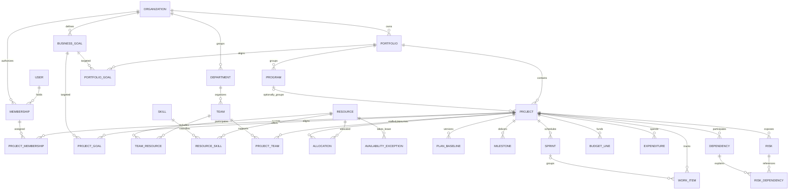
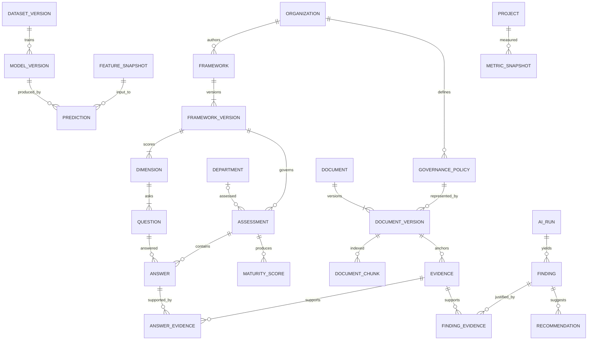
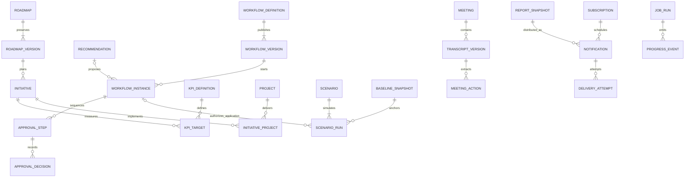

# Conceptual data model

**Historical/proposed reference:** Current availability is [CURRENT_STATUS](../00-overview/CURRENT_STATUS.md); current architecture is [SYSTEM_ARCHITECTURE](../01-architecture/SYSTEM_ARCHITECTURE.md); future execution order is [the revised roadmap](../09-planning/FUTURE_SPRINT_ROADMAP.md). Preserve dated decisions/scope below; proposed components are not implementation claims.

Sprint 04 implemented schema: [delivery contract](../contracts/delivery.md) maps all 19 resources and invariants. Current metadata is `ppm_tables.py`, frozen migration `0003_delivery`; organization/project composite references, explicit grants, immutable baseline/ledger/status history and audited revisions extend the identity schema. Resources/capacity remain Sprint 05.

Sprint 02 physical subset: migration `0002_identity` adds `identity_users`, `organizations`, `memberships`, `identity_sessions`, `identity_refresh_tokens`, `identity_challenges` and `identity_audit`. The immutable Sprint 01 installation checkpoint remains. See [ADR 008](adr/008-identity-implementation.md) for global credential versus tenant-owned table boundaries, composite keys and RLS. No other entities in the conceptual model are implemented yet.

Version 0.1. These are planned logical entities, not applied tables or migration instructions. All tenant-owned entities carry `organization_id`, stable UUID, created/updated UTC timestamps and appropriate revision/audit metadata. Exceptions are global identity and shared non-sensitive catalog definitions. Use composite `(organization_id, id)` parent references to prevent cross-tenant relationships. Tenant role is not a global user property.

## Organization and delivery relationships

`Dependency` has typed source and target project/milestone/work-item references; both ends must be validated in the same organization. Schedule predecessor edges must form a DAG; other graph relationships may contain cycles. A project has exactly one portfolio and zero/one program belonging to that same portfolio. A department/team resource link is dated; team totals must not double-count resources with overlapping memberships. Team membership is not a permission grant. Resource login association is optional.

## Assessment evidence and intelligence

Assessment target is exactly one typed organization/department/team target. The diagram shows the department relation as an example; enforce target exclusivity explicitly. Answer may have multiple review revisions. MaturityScore distinguishes deterministic, AI-suggested and approved values, with rubric and reviewer references. Policy has immutable versions; a document may implement a policy version but not every document is a policy.

Evidence uses an explicit source-kind and immutable source-version reference. Page/paragraph/sheet/cell or transcript-time span must be valid for that source. Document permissions constrain findings and derived material; deletion/revocation triggers index/cache cleanup. Relational evidence can point to baseline/metric versions using validated typed references, not unchecked foreign IDs. Model versions reference dataset hashes and evaluation reports; prediction inputs retain as-of feature versions.

## Decisions and delivery

Workflow instance stores typed action payload, expected target versions and idempotency key. Approval does not imply successful execution. A scenario run can be linked to one apply workflow; the relation does not authorize every run. Action conversions retain originating transcript/action IDs to deduplicate. Report snapshot and notification audiences are captured and rechecked at delivery; expired access may invalidate downloads.

## Entity ownership and key invariants

| Owner and sprint | Additional entities and critical fields | Integrity rule |
| --- | --- | --- |
| Identity 02/22 | Session, RefreshCredential, Invitation, Passkey; user/membership/session IDs | Refresh rotation atomic; passkey challenge single-use; final active admin retained |
| Organization/PPM 04 | StatusUpdate, ProjectBenefit, ProjectGoal, Goal weights, Currency | Immutable baseline versions; explicit money currency; status history audited |
| Resource 05 | CalendarVersion, EffortEntry, AvailabilityException | Allocation intervals use start-inclusive/end-exclusive dates; calendars versioned |
| Assessment 06 | RubricLevel, ReviewerAssignment, ScoreOverride | Published questions/weights immutable; overrides require reviewer reason |
| Metrics 07 | RiskRuleVersion, SavedView, KPI definition | Metric identity includes definition version, as-of, period, currency and scope |
| Ingestion 08 | Connector, MappingVersion, SourceRecord, SyncCursor, OutboxEvent, InboxReceipt | Unique source system/entity external ID per tenant; commit cursor only after accepted records |
| Documents 09 | ObjectReference, ExtractionCandidate, EmbeddingIndexVersion | Quarantined until validation; content hash does not permit cross-tenant dedup exposure |
| AI 10/11 | PromptVersion, ToolPolicy, AIUsage, AgentResult | Provider model/rule/prompt IDs stored; missing results are not zero risk |
| ML 12/13 | FeatureDefinitionVersion, ModelEvaluation, PredictionOutcome | No future data in feature cutoff; no promotion without recorded criteria |
| Copilot 14 | Conversation, Message, QueryPlan, AnswerCitation, Feedback | Conversation scope cannot silently broaden in a follow-up |
| Workflow 15 | SLATimer, AuthorizedAction, DecisionLogEntry | One logical execution per approved action; stale target aborts |
| Transformation 16 | BenefitTarget, InitiativeDependency | Roadmap dependency DAG and recorded assumptions |
| Scenario 17 | ScenarioChange, ScenarioResult | Immutable baseline; live apply validates all affected versions atomically |
| Graph 18 | GraphCheckpoint, ConfirmedRelationship | Neo4j derived; explicit deletion/rebuild semantics |
| Benchmark 19 | CohortDefinition, BenchmarkRun | Metric/rubric/period compatibility checked; within tenant only |
| Meeting 20 | RecordingObject, SpeakerLabel, MinutesVersion | Consent/authority recorded; ambiguous owners/dates not auto-confirmed |
| Reporting 21 | ReportSchedule, RecipientPolicy, AudioObject | Recipient allowed at generation and delivery; retry history preserves ambiguity |
| Cross-cutting 02 onward | AuditEvent, DataRetentionPolicy | Append-only application audit permissions; purge policy is explicit and separately authorized |

The ER diagrams omit repeated Organization ownership edges for readability, not for implementation. Join records also carry organization scope and composite constraints. Hard deletes, tombstones and retained audit references need per-entity policy before production data intake. No retention duration is inferred from source silence.
# Sprint 05 implementation extension

Migration `0004_capacity` adds independent resource profiles, skills, immutable
calendar versions, dated availability/reporting teams/time off/project allocations,
resource capability grants, restricted daily effort and coverage, and immutable
allocation snapshots. Existing login membership is not a resource profile. Composite
tenant references, revisions and audit preserve identity and history boundaries.
See [capacity contract](../contracts/capacity.md) and [ADR 011](adr/011-resource-capacity.md).
