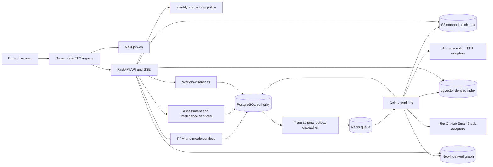

# Proposed system architecture

Sprint 04 implements the local portfolio/delivery system of record; see [ADR 010](adr/010-delivery-system-of-record.md) and [delivery contract](../contracts/delivery.md). Later intelligence, capacity, assessments and cloud components remain planned. Historical checkpoint descriptions below retain their original scope.

Sprint 03: local enterprise shell implemented; [ADR 009](adr/009-enterprise-shell.md) and [frontend contract](../contracts/frontend.md) define components, themes and scope. No backend/schema changes.

Sprint 02 update: the local identity/session API, same-origin web transport, organization membership policies, tenant RLS and local mailbox are now implemented. [ADR 008](adr/008-identity-implementation.md) describes these boundaries. Project, portfolio, intelligence, workflow and cloud components below remain planned.

Version 0.1, Sprint 00, 2026-10-05. This is a design baseline, not deployed infrastructure. Read the [decision register](../requirements/decisions-and-assumptions.md) and [ADRs](adr/README.md) for alternatives and unresolved organizational choices.

Sprint 01 implements the local web/API/worker, PostgreSQL/Redis and filesystem-storage subset. [ADR 007](adr/007-sprint-01-runtime.md) and the [Sprint 01 report](../sprints/SPRINT-01-REPORT.md) identify the verified runtime. The diagrams below remain the broader target architecture; identity is implemented, while domain, AI and cloud components remain planned.

## Components and flow

All data paths, including vector/graph reads and file downloads, pass the same tenant/project policy. The diagram's direct arrows indicate service access, not permission bypass. API writes persist canonical domain data and outbox entries atomically; workers perform expensive/external effects and publish observable progress. The web never receives service credentials. Ingress routes web and `/api/v1` under one origin; a separate gateway product is unnecessary initially.

## Module ownership and interfaces

| Module | Owns | Inputs | Outputs and consumers | Prerequisites |
| --- | --- | --- | --- | --- |
| Identity | Users, memberships, sessions, credentials | Verified identity and admin actions | Authorized principal for every service | Runtime |
| Organization/PPM | Departments, goals, portfolios, programs, projects, work, baselines, budgets | Validated scoped edits/imports | Canonical snapshots for metrics/AI/workflows | Identity |
| Resources | Teams, skills, capacity, allocations, effort | Calendars and staffing edits | Availability/utilization for metrics/scenarios | PPM |
| Assessments | Framework versions, questions, answers, reviews, scores | Answers and scoped evidence | Deterministic maturity scores and gaps | PPM, identity |
| Metrics/dashboard | Metric definitions, metric snapshots, saved views, risk register | PPM/resources/assessments | Versioned aggregate DTOs; drill-down evidence | Core data |
| Ingestion/jobs | Connector mappings, cursors, job runs, outbox, progress | Signed events/imports/domain events | Normalized candidate changes; durable runs | PPM |
| Document intelligence | Document versions, chunks, evidence, extraction candidates | Validated/quarantined uploads | Scoped retrieval and reviewable findings | Jobs/storage |
| AI runtime | Prompt/tool versions, provider adapters, AI runs | Authorized snapshots and tool requests | Typed validated outputs and usage | Jobs/documents |
| Agents | Specialized agent policies and aggregation | Facts, rubric/policy evidence | Findings/recommendations; no autonomous writes | AI runtime/metrics |
| ML analytics | Datasets, feature snapshots, model registry, forecasts | Historical as-of facts and outcomes | Eligible forecasts with model cards | Ingestion/metrics |
| Copilot | Conversations, validated query plans, feedback | User question and permitted context | Tables/charts/citations/action drafts | Metrics, retrieval, AI |
| Workflow | Definitions/versions, requests, steps, decisions, SLA timers | Typed action requests and due events | Audited approvals and authorized domain commands | Jobs/identity |
| Transformation | Roadmaps, initiatives, benefit/KPI targets, decision log | Gaps, goals, recommendations | Approved plan versions and linked projects | Agents/workflows |
| Simulation | Baseline snapshots, parameter sets, scenario runs | Resource/funding changes | Hypothetical deltas; approved apply request | Resources/metrics/workflow |
| Graph | Projection checkpoints and derived nodes/edges | Canonical records and approved relationships | Bounded paths and graph DTOs | PPM/documents/jobs |
| Benchmarking | Cohort definitions and comparison runs | Compatible metric snapshots | Suppressed/qualified within-tenant comparisons | Assessments/metrics |
| Meetings | Recording/transcript versions, draft minutes/actions | Authorized audio/text | Reviewed actions/evidence into PPM | Jobs/documents/AI/workflow |
| Reporting/delivery | Report snapshots, subscriptions, notifications, attempts, audio | Shared metrics, approved recipients/schedules | Authorized files, messages and briefing audio | Jobs/agents/workflow |

Modules may read through explicit service contracts; only the owning module mutates its records. AI and natural-language analytics use allowlisted typed tools rather than arbitrary SQL. Generated TypeScript clients derive from backend OpenAPI. Proposed repository directories: `apps/web`, `services/api`, `services/worker`, `packages/contracts`, `infra`, `tests`, `docs`; only `docs` is created in Sprint 00.

## Incremental dependency rule

Sprint 09 provides extraction storage, OCR, retrieval and deterministic candidate parsing through interfaces. Its LLM-enhanced semantic extraction must remain disabled until the Sprint 10 gateway exists, then receive integration acceptance in Sprint 11. Do not build a second ad-hoc provider client in Sprint 09. Likewise Sprint 06 uses a local assessment review state machine before generic workflows arrive; Sprint 15 wraps/migrates it through the owning assessment service and preserves historical decisions. Sprint 14 can save action drafts; execution starts only through Sprint 15 workflows. These boundaries avoid forward dependencies in the original prompts.

Sprint 13 can serve explicitly labeled deterministic fallbacks if models cannot be promoted. This enables downstream product work without pretending production ML is complete. Coverage for model accuracy stays open.

## Failure and ownership guarantees

Database commits define accepted domain changes. Redis is not a system of record. Reconciliation can republish unfinished jobs; repeated messages must not repeat domain effects. External delivery has recorded attempt IDs and ambiguous-success recovery. SSE is resumable only within retention; older clients receive a snapshot/resync response. Graph/vector indexes are rebuildable and expose lag; unavailable projections do not break transactional PPM.

Provider failure produces explicit unavailable/degraded output, never a fabricated successful answer. Heavy OCR/training/inference/export runs use separate worker queues with bounded concurrency. Every workload has timeout, cancellation and limits. Row-policy transaction context and user authority are reconstructed on every worker execution; a serialized job tenant ID alone is not authorization.

## Security and operations boundaries

Identity is global; membership and business data are organization-scoped. A membership switch mints a scoped session context only after membership validation. Storage paths include organization/document IDs but are not security controls alone. Downloads, graph, vectors, caches and exports recheck policy. Audit records store actor, scope, action and references without credentials/raw prompts containing sensitive notes.

Proposed worker categories: ingestion/documents, AI, ML, notifications/reporting. Deployment scales them independently. Configuration separates demo, test and production. Production AI budgets, retention, regions and recovery targets require actual organizational values; no prices, throughput or accuracy are assumed.
